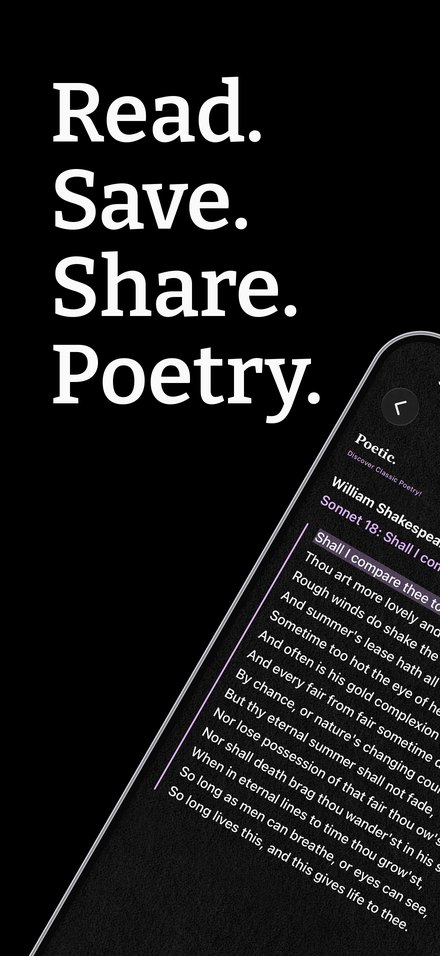
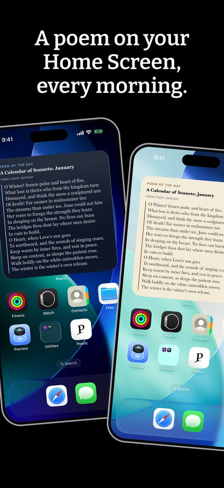
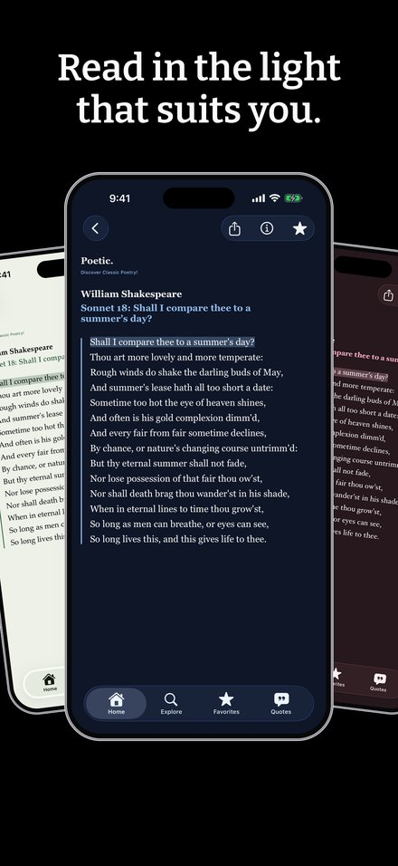
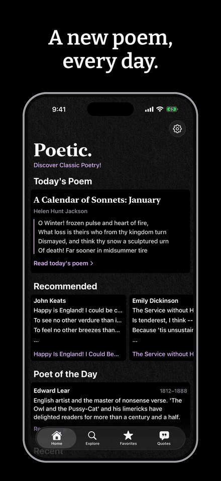
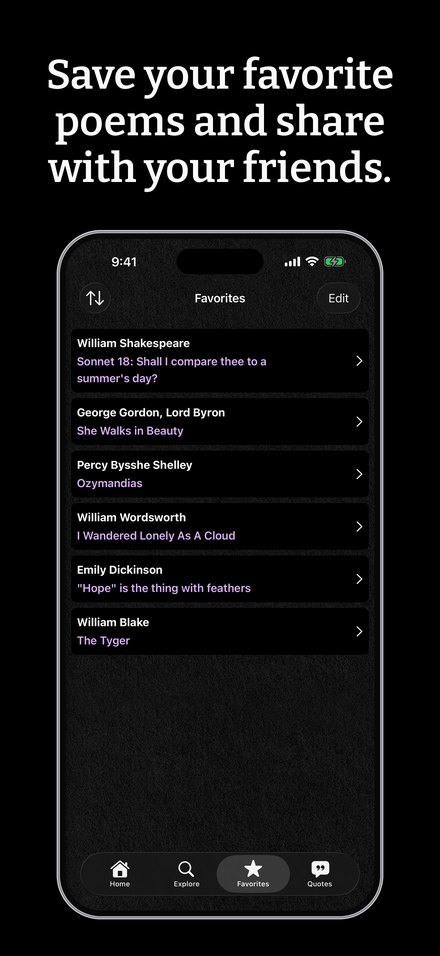
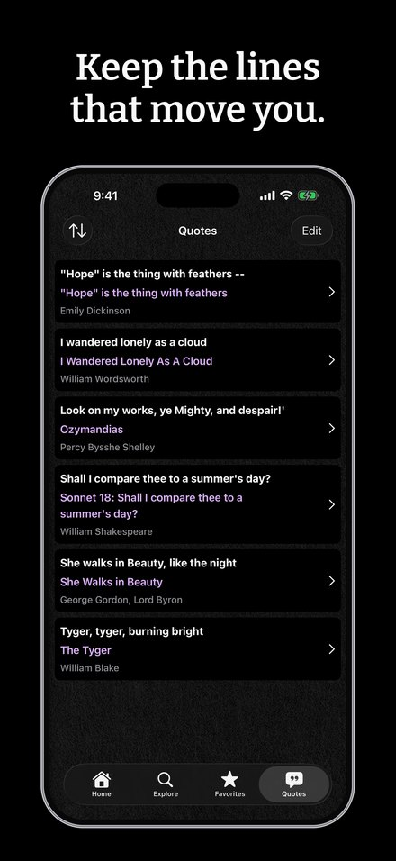
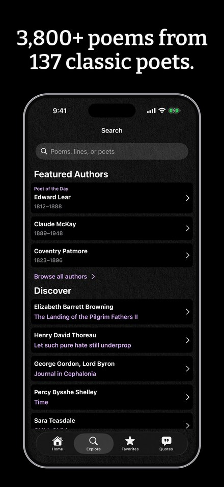

# Poetic

Poetic brings classic English poetry to your fingertips. Read, save and share thousands of poems from 137 of the greatest poets – fully offline, beautifully themed, and right on your Home Screen. Built out of a love of poetry and as an ongoing iOS learning journey.

<p>
  
  
  
  
  
  
  
</p>

## Features

- **3,800+ poems, offline** – a bundled catalog from PoetryDB and Project Gutenberg, so everything works without a connection.
- **Today's Poem & Poet of the Day** – a new poem and a new poet to discover every day.
- **Home Screen widgets** – a free Poem of the Day widget in small, medium and large, plus a Favorites widget that rotates through your own anthology.
- **Six reading themes** – Paper, Sepia, Sage, Midnight, Rose and Ink, each with light and dark modes and a classic serif. Widgets follow your theme.
- **Search everything** – poets, titles and lines of poetry, all in one search.
- **Favorites & quotes** – star poems, long-press a line to highlight and save it, and share either with friends.
- **Tip jar** – Poetic is free and always will be; any tip unlocks the extra themes and the Favorites widget as a thank-you.

## Tech

- SwiftUI, iOS 17+
- Core Data for favorites, quotes and reading history
- WidgetKit with an App Group for the widgets
- StoreKit 2 for tips
- Firebase Analytics and Crashlytics
- A Python catalog pipeline in `Tools/catalog` (PoetryDB + Project Gutenberg)
- Unit tests in `PoeticTests`, plus a UI-test runner in `PoeticUITests` that captures the App Store screenshots (`Tools/compose_screenshots.py` frames them)

## Download

Get Poetic on the [App Store](https://apps.apple.com/us/app/poetic/id1614416936).

To run it locally, clone the repo and open `Poetic.xcodeproj` in Xcode:

```bash
git clone https://github.com/thompson-dean/Poetic.git
```

## Contribute

Poetic is open source and contributions are welcome:

- Submit pull requests to fix issues or add features
- Improve the documentation
- Report bugs

## Learning Journey

Poetic started as a way to learn SwiftUI and has grown with every release: Core Data (including a schema migration), MVVM with Combine and async/await, Share Sheets, context menus, UserNotifications, WidgetKit and App Groups, StoreKit 2, theming through the SwiftUI environment, Firebase, unit and UI testing, and an automated App Store screenshot pipeline. A big thank you to [100 Days of SwiftUI by Paul Hudson](https://www.hackingwithswift.com/100/swiftui) for laying the foundation.

## Contact

Questions, ideas, or just want to say hi? Find me on Twitter:
<a href="https://twitter.com/DeanWThompson" target="_blank">
  
</a>
